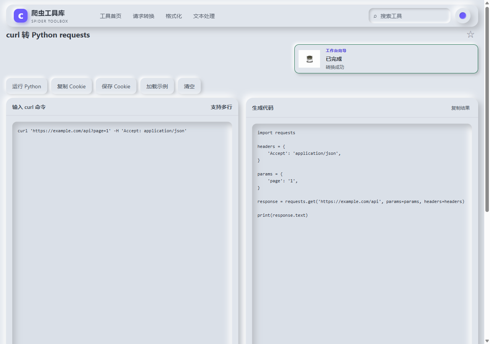
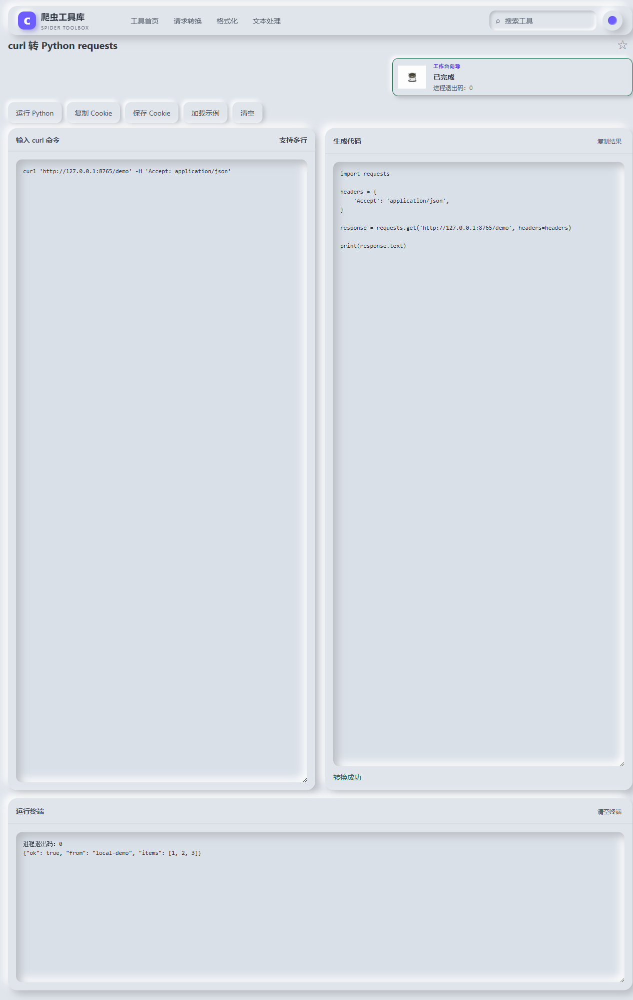
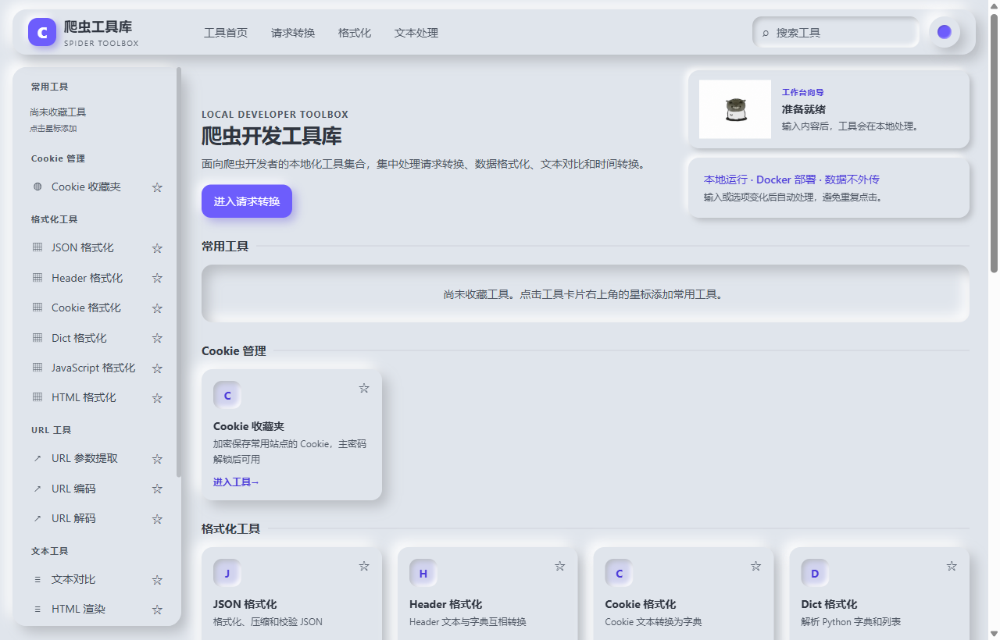

# curl2py

把浏览器「Copy as cURL」的请求转成可直接运行的 **Python 代码 / feapder 爬虫**，附带 Cookie 收藏夹、哈希、图片转 Data URL 等本地小工具。

三种交付形态，按场景选一种即可：

| 形态 | 适合 | 入口 |
| --- | --- | --- |
| **Windows 安装版** | 长期在本机使用，要桌面快捷方式 | [下载 `setup.exe`](#windows-下载) |
| **Windows 绿色版** | 不想安装、放 U 盘、要多个版本并存 | [下载 `portable.exe`](#windows-下载) |
| **Docker 镜像** | 装在 NAS / 服务器，多人或跨设备访问 | [Docker 部署](#docker-部署) |

---

## Windows 下载

前往 **[Releases](https://github.com/ongs68710/curl2py/releases/latest)** 下载，三个文件按需选一个：

| 文件 | 类型 | 体积 | 怎么用 |
| --- | --- | --- | --- |
| `curl2py-0.5.3-win-x64-setup.exe` | **安装版** | 105.2 MB | 双击走安装向导，装完从桌面/开始菜单启动 |
| `curl2py-0.5.3-win-x64-portable.exe` | **绿色版（单文件）** | 105.0 MB | 双击直接用，不写注册表、不建快捷方式 |
| `curl2py-0.5.3-win-x64-green.zip` | **绿色版（压缩包）** | 142.3 MB | 解压到任意目录，双击里面的 `curl2py.exe` |

> 只想要「打开就能用、以后好删干净」→ 选 `portable.exe`。  
> 想要「桌面图标 + 开始菜单 + 卸载程序」→ 选 `setup.exe`。

### 安装版 vs 绿色版

| | 安装版 `setup.exe` | 绿色版 `portable.exe` | 绿色版 `green.zip` |
| --- | --- | --- | --- |
| 是否需要安装 | 需要，走向导 | **不需要** | **不需要** |
| 安装位置 | 自选目录，会自动补 `curl2py` 子文件夹 | 原地运行（自解压到临时目录） | 解压目录，原地运行 |
| 程序与数据位置 | `%APPDATA%\curl2py` | **exe 同级 `curl2py-data\`** | exe 同级 `curl2py-data\` |
| 快捷方式 | 桌面 + 开始菜单 | 无 | 无 |
| 卸载方式 | 卸载程序（可选一并删数据） | 删掉 exe 与 `curl2py-data` 目录 | 删掉整个解压目录 |
| 首次启动 | 约 1 秒 | 约 10 秒（先自解压 105 MB） | 约 1 秒 |
| 与另一版本共存 | ✅ 可同时运行 | ✅ 可同时运行 | ✅ 可同时运行 |
| 系统要求 | Windows 10 1809+ / x64 | 同左 | 同左 |

绿色版的数据、日志、收藏夹库全部落在 `curl2py-data\` 里，**不写 AppData、不写注册表**，
整个目录可以直接拷走；目录只读（光盘、写保护 U 盘）时会自动回退到用户目录。

> 未做代码签名，首次运行 Windows SmartScreen 会提示「已保护你的电脑」，
> 点「更多信息 → 仍要运行」即可。

### 界面预览

<table>
  <tr>
    <td width="50%"><br><sub>粘贴 curl，右侧即时生成 requests 代码</sub></td>
    <td width="50%"><br><sub>点「运行 Python」直接执行，终端显示真实返回</sub></td>
  </tr>
  <tr>
    <td colspan="2"><br><sub>首页：左侧工具导航，右侧工作台向导（本地运行 / Docker 部署）</sub></td>
  </tr>
</table>

---

## Docker 部署

镜像地址：**[hub.docker.com/r/szs3/curl2py-web](https://hub.docker.com/r/szs3/curl2py-web)**

多架构 manifest（`amd64` / `arm64` / `armv7`），`docker pull` 会按设备自动匹配。

### 最快上手（只跑 Web）

```bash
docker pull szs3/curl2py-web:0.5.3

docker run -d --name curl2py --restart unless-stopped \
  -p 9997:5000 \
  -v curl2py-data:/app/data \
  -e TZ=Asia/Shanghai \
  -e VAULT_ENABLED=1 \
  -e VAULT_KDF_ITERATIONS=120000 \
  -e GUNICORN_WORKERS=4 \
  szs3/curl2py-web:0.5.3
```

打开 `http://<主机IP>:9997`。首次使用 Cookie 收藏夹时设置主密码。

### Web + MCP（给 AI 客户端用）

```bash
# MCP 服务（与上面的 Web 容器共用镜像）
docker run -d --name curl2py-mcp --restart unless-stopped \
  -p 9999:9999 \
  -v /opt/curl2py/mcp-files:/files:ro \
  -e TZ=Asia/Shanghai \
  -e CURL2PY_BASE_URL=http://<宿主机IP>:9997 \
  --entrypoint python \
  szs3/curl2py-web:0.5.3 \
  /app/mcp/server.py --transport http --host 0.0.0.0 --port 9999 --max-concurrency 64
```

常用地址：

| 地址 | 用途 |
| --- | --- |
| `http://127.0.0.1:9997` | Web 界面 |
| `http://127.0.0.1:9997/health` | Web 健康检查 |
| `http://127.0.0.1:9999/health` | MCP 健康检查 |
| `https://hub.docker.com/r/szs3/curl2py-web/tags` | 全部 tag（含各架构） |

完整运维手册（拉取 / 备份 / 排障 / 升级回滚）见 Docker Hub 仓库页的 Overview。

---

## 功能

- **curl → Python**：`requests` 代码，method、headers、params、data、cookies、文件上传全部还原
- **curl → feapder**：直接生成 `GeneratedSpider` 类
- **Cookie 收藏夹**：主密码 + scrypt KDF（12 万次迭代）+ AES-GCM 加密落盘，重启自动回锁
- **哈希 / Base64 / 图片转 Data URL**
- **运行 Python / 终端**：在桌面版里直接跑转换出的代码（每会话随机令牌鉴权、12 秒超时、128 KB 上限、cwd 限定临时目录）

## 安全设计

- 后端只监听 `127.0.0.1`，局域网不可直连
- 每次启动生成随机 API 令牌，注入页面后随请求头 `X-API-Token` 发出；不落盘、不打印
- WSGI 层统一加 `nosniff` / `DENY` / `no-referrer` / CORP / Permissions-Policy
- 收藏夹库用主密码派生密钥加密，密钥只在内存缓存，进程退出即失效

自检脚本 `python .bench/run_sec.py`，24 项检查（监听范围、鉴权、脚本沙箱、路径穿越、体积限制、MCP 隔离、签名与票据、安全头、错误不泄露）全部通过。

## 开发与构建

```bash
npm install
unset ELECTRON_RUN_AS_NODE          # 宿主若设了该变量，Electron 会被当纯 Node 跑

npx electron-builder --win --x64    # 一次产出 setup.exe / portable.exe / green.zip
```

架构说明、依赖锁定、踩坑记录、压测与资源数据见 **[构建与架构说明.md](构建与架构说明.md)**。

回归验证：

```bash
python .bench/run_sec.py            # 24 项安全自检
python .bench/run_bench.py v 5      # 21 场景压测（c=1/8/32）
python .bench/measure.py            # 启动时间 + 进程内存
python .bench/verify_portable.py    # 绿色版数据目录与 HTTP
```

## 性能与资源（本机实测）

| 项 | 数值 |
| --- | --- |
| 启动到页面可用 | 0.87 ~ 1.1 秒 |
| 空闲内存（Electron 4 进程 + Python 后端） | 404.5 MB |
| 后端空闲 / 压测后 | 45.8 MB / 60.6 MB（无泄漏） |
| curl → Python 吞吐 | 2462 rps（32 并发，p50 11.7 ms） |
| 收藏夹列表吞吐 | 1739 rps（32 并发，0 错误） |
| 静态资源 | 305 KB |

## 许可

仓库内为应用与打包工程源码。使用前请自行确认目标站点的服务条款与抓取合规要求。
